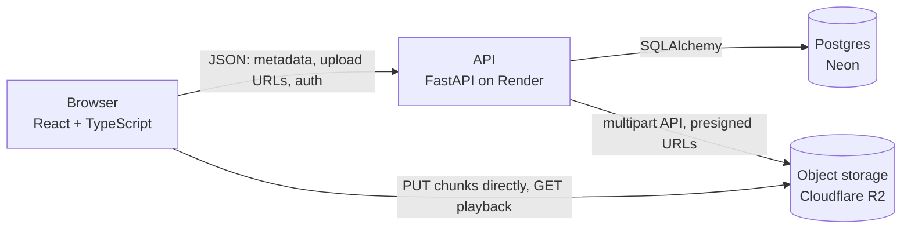
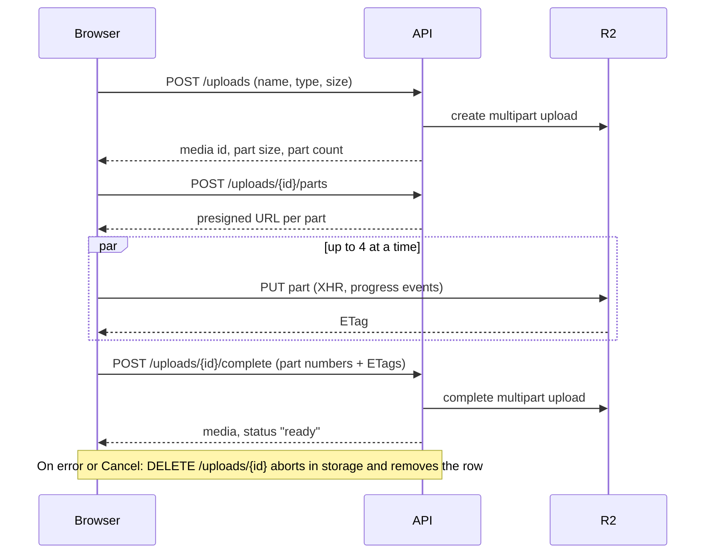

# Media Upload

A video library where large files upload **straight from the browser to object storage**, in parallel
chunks, with live progress, cancel, and role-based permissions.

**[Live demo](https://media-upload-six.vercel.app/)** · **[Case study](docs/case-study.md)**

> The demo has no sign-up: use **View as** in the header to switch between Guest, Viewer, Editor
> and Admin. The API runs on a free tier and may take ~30 seconds to wake up on the first visit.

## Features

- **Chunked direct uploads** up to 200 MB: the file is split into 10 MiB parts, four are sent in
  parallel straight to Cloudflare R2 through presigned URLs, so file bytes never touch the API.
- **Live progress** with speed and time remaining, **cancel** at any point, several files at once.
- **Global upload panel**: uploads keep running while you browse, and the browser warns before you
  close a tab mid-upload.
- **Library** with search, status filter and pagination, all kept in the URL (shareable, back
  button works).
- **Detail page** with a player, inline editing (title, description, tags) and delete.
- **Roles**: guests and viewers browse, editors upload and edit, admins also delete. Enforced by
  the API with signed tokens; the UI only mirrors it.
- **Accessible**: keyboard-only flows, focus management, labelled controls, checked with
  eslint-plugin-jsx-a11y and axe.

## Architecture



How one upload flows:



## Tech stack

|                    |                                                                                            |
| ------------------ | ------------------------------------------------------------------------------------------ |
| **Frontend**       | React 19, TypeScript (strict), Vite, TanStack Query, React Router, Tailwind CSS, shadcn/ui |
| **Backend**        | Python 3.12, FastAPI, SQLAlchemy 2, Alembic, Pydantic, boto3, PyJWT                        |
| **Infrastructure** | Vercel (frontend), Render (API, Docker), Neon (Postgres), Cloudflare R2 (files)            |
| **Quality**        | Vitest + Testing Library, pytest, ESLint + jsx-a11y, Ruff, GitHub Actions, pre-commit hook |

## Testing

- **API (pytest):** every endpoint, the full upload flow against a fake storage, storage failures,
  token validation, and a permission table of every role against every action.
- **Frontend (Vitest + Testing Library):** the upload engine (chunking, ETags, clean-up on failure
  and cancel) with a fake `XMLHttpRequest`, the edit form, the upload list, the library page,
  formatting and permissions.

CI runs lint, format, type checks, build and both test suites on every pull request.

## Run it locally

Prerequisites: Node.js 22+, [uv](https://docs.astral.sh/uv/), Docker.

```bash
# 1. Database
docker compose up -d

# 2. API: http://localhost:8000 (docs at /docs)
cd api
cp .env.example .env          # fill in the S3_* values for uploads
uv sync
uv run alembic upgrade head
uv run python -m app.seed     # sample data, safe to run again
uv run uvicorn app.main:app --reload

# 3. Frontend: http://localhost:4000, in a second terminal
cd web
cp .env.example .env.local
npm install
npm run dev
```

### Checks

|        | API (`cd api`)         | Frontend (`cd web`) |
| ------ | ---------------------- | ------------------- |
| Tests  | `uv run pytest`        | `npm test`          |
| Lint   | `uv run ruff check .`  | `npm run lint`      |
| Format | `uv run ruff format .` |                     |
| Build  |                        | `npm run build`     |

### Storage setup

Create an R2 (or S3) bucket and an access key, and fill in the `S3_*` values in `api/.env`. The
bucket needs:

- a **CORS rule** allowing `PUT` and `GET` from the frontend origin and exposing the `ETag` header;
- a **lifecycle rule** that aborts incomplete multipart uploads after one day.

### Database migrations

```bash
cd api
uv run alembic revision --autogenerate -m "describe the change"
uv run alembic upgrade head
```

## Demo limits

Because the demo is public: files up to 200 MB, 2 GB in total, uploads abandoned for over a day are cleaned up automatically, and `app.seed` restores any deleted sample items.
